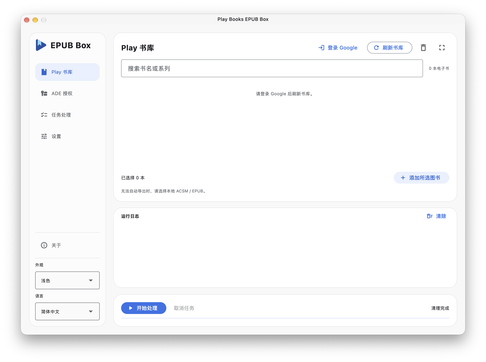

# Play Books EPUB Box

从 Google Play 图书获取 EPUB 电子书文件，自动匹配并替换高清插图，无需安装 Adobe Digital Editions 或 Calibre。

## 界面预览



## 安装与启动

需要先安装 [uv](https://docs.astral.sh/uv/getting-started/installation/) 并且系统内有 Chrome 或 Edge 浏览器。以下使用 uv 管理的独立 Python 3.12 环境。
项目应放在当前用户可写的短路径，Windows 下例如 `C:\Users\你的用户名\PlayBooks`，避免系统目录及公共同步目录。

首次安装：打开终端，先进入项目目录，再执行：

```sh
uv sync
uv run python playbooks_app.py gui
```

打开项目界面后，完整流程需先在「ADE 授权」导入已有授权或登录授权，以及在「Play 书库」登录你的 Google 账号。
成功登录后会自动关闭当前登录浏览器并获取账号内书籍信息，可以批量选中并添加任务，也可在「任务处理」添加本地 ACSM / EPUB。
后续抓图默认无窗口运行，完成后关闭本工具启动的浏览器。

## CLI

在项目目录运行以下命令：

```sh
uv run python playbooks_app.py status
uv run python playbooks_app.py login-google
uv run python playbooks_app.py process --input "书籍.acsm"
uv run python playbooks_app.py process --input "书籍.epub" --id "卷ID"
uv run python playbooks_app.py process --input "书籍.acsm" --prepare-only
uv run python playbooks_hires.py inspect --epub "书籍.epub"
```

更多参数见 `--help` 和 [使用说明](docs/QUICKSTART.md)。

## 目录与隐私

实现位于 `src/playbooks/`；根目录的三个 Python 文件分别提供主程序入口、GUI 入口与抓图 CLI。

- `.playbooks-state/`：ADE 授权和获取的 EPUB。
- `.chrome-profile/`：独立浏览器登录配置。
- `playbooks_work/`：原图与章节缓存；可在 GUI 中移至回收站。
- `.flet-settings.json`：外观和语言偏好。

默认路径相对于项目目录。授权、登录配置、书籍和缓存已列入 `.gitignore`，请勿手动上传或公开共享。
本项目基于 DeACSM 与 DeDRM 插件，感谢开源，第三方版本、修改和许可见 [第三方说明](docs/THIRD_PARTY.md)。
